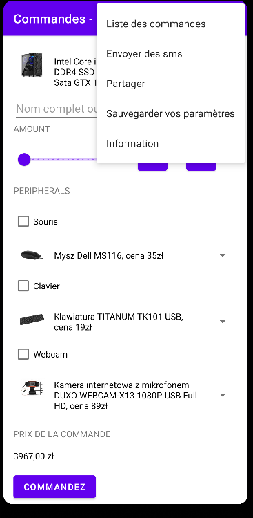
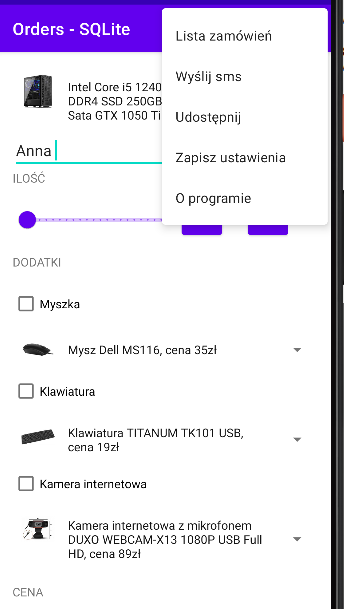

# Projekt zaliczeniowy - 15 marzec

Widok po prawej to tylko propozycja.
Tematyka sklepu dowolna, ale wymaga akceptacji ze strony nauczyciela.

   

Pomocnicze ćwiczenia do realizacji to

ćwiczenia 16 i 21, które będą realizowane na zajęciach.

Napisz aplikację, która:

1. Zapisze zamówienie użytkownika w bazie SQLite, dla zestawu
komputerowego lub własnego, użytkownik może wybrać spośród 3 pozycji dla:
   - komputera ( opis + zdjęcie)
   - klawiatury ( opis + zdjęcie)
   - myszki ( opis + zdjęcie)
   - camery internetowej lub monitora ( opis + zdjęcie)
1. Wyśle emaila z treścią zamówienia lub/i wyśle sms z treścią
   zamówienia.
1. Zamówienie powinno obejmować powyższe, a dodatkowo:
   - cenę
   - datę zamówienia (format data i czas)
   - nazwę firmy lub imię i nazwisko zamawiającego ( nie może być puste)

1. Pozwoli odczytać zamówienia z pomocą ListView,

1. Dodaj ikonę aplikacji.

1. Należy zerować po zapisie cenę dla nowego zamówienia

1. Posiada menu z pozycjami na obsługę:
   - listy zamówień
   - zapisania ustawień (koszyka)
   - informacje o autorze programu
   - udostępnienie zawartości koszyka
   - wysłanie smsa
1. Zadania na ocenę bardzo dobrą ( powyższe zadania oraz ):
   - wersja dwujęzyczna PL/En (domyślnie polski)
   - wysłanie smsa z zamówieniem
   - zapisanie stanu zamówienia i odtworzenie (SharedPreferences,
     onRestoreInstanceState)
   - skróty dynamiczne ( minimum 2, najlepiej 4)
1. Zadania na ocenę celującą ( powyższe zadania oraz ):
   - logowanie do aplikacji z rejestracją
   - zapisanie zdjęcia w bazie w postaci Stringa i jego poprawny odczyt
   - udostępnienie zamówienia z menu, aplikacja do wyboru
   - wysłanie maila w tle

   
