# Ćwiczenia 17 -- Android studio -- GPS, Open Street Maps

Na koniec zajęć prześlij pliki źródłowe (.xml, .java)+ obrazek do zasobu
w teams.

1. Utwórz projekt o nazwie GpsMaps na podstawie Empty Views Activity, dobierz odpowiednie API ( min. 28 ).

1. Otworzyć dokumentację:

   <https://developer.android.com/training/location/permissions>

   <https://developer.android.com/reference/kotlin/android/location/LocationManager?hl=en>

   <https://developer.android.com/training/location/request-updates>

   <https://developer.android.com/reference/android/location/Location>

1. Dodaj zależności ( aktualna wersja na

   <https://github.com/osmdroid/osmdroid>):

   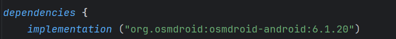

1. Docelowo chcemy uzyskać coś na kształt( marker ustawić na
    czerwony!!!):

   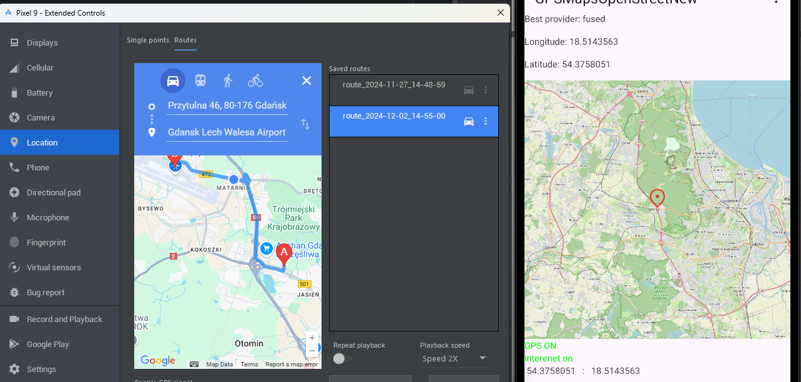

1. Stwórz podstawowe struktury np.:

   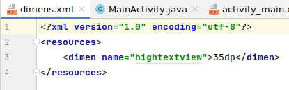

1. Stwórz layout dla aplikacji jak poniżej lub podobny:

   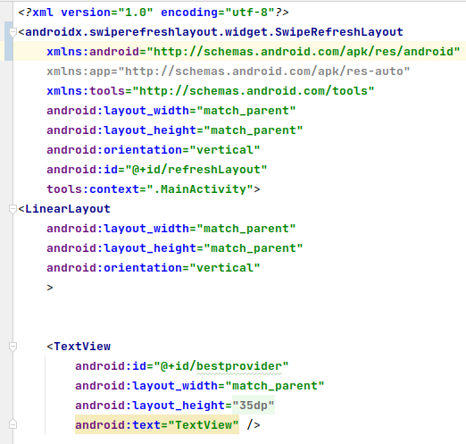

   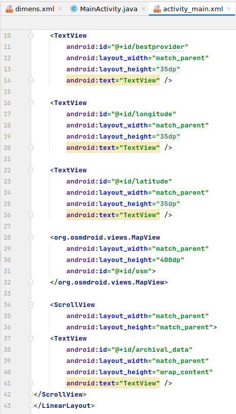

1. Dodaj listener dla layoutu SwipeRefreshLayout:

   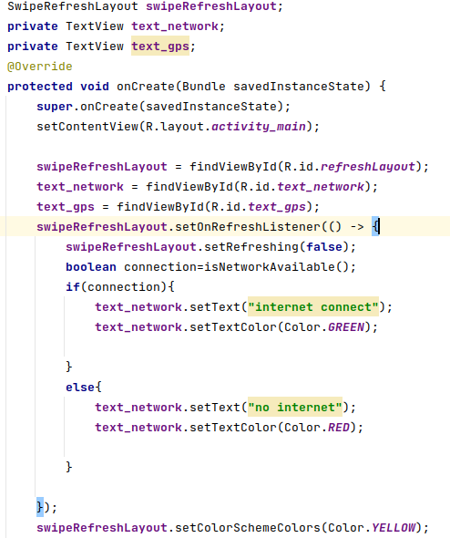

1. Zadeklaruj w MainActivity.java:

   ```java
   SwipeRefreshLayout swipeRefreshLayout;

    private final String[] permissions = {
            Manifest.permission.ACCESS_FINE_LOCATION,
            Manifest.permission.ACCESS_COARSE_LOCATION,
            Manifest.permission.INTERNET
    };
    private TextView longitude;
    private TextView latitude;
    private TextView archivaldata;
    private TextView text_network;
    private TextView text_gps;
    private MapView map;
    private MapController mapController;
   ```

1. W onCreate() dodaj:

   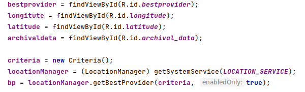

1. Dodaj ( ważne: zwróć uwagę na kolejne dwa punkty!!! ):

   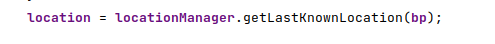

1. W AndroidManifest.xml sprawdź czy masz uprawnienia:

   ```xml
   <uses-permission android:name="android.permission.ACCESS_FINE_LOCATION" />
    <uses-permission android:name="android.permission.ACCESS_COARSE_LOCATION" />
   ```

1. Sprawdź czy zaimplementowałeś/aś metodę
    onRequestPermissionResult, albo lepiej dodaj launcher:

   ```java
   private final ActivityResultLauncher<String[]> requestMultiplePermissionsLauncher =
            registerForActivityResult(new ActivityResultContracts.RequestMultiplePermissions(),
   ```

1. Add permission check ( if z checkSelfPermission doda się
    automatycznie po wybraniu tej opcji)

   W trakcie realizacji ćwiczeń należy dodać stosowne inne, wymagane uprawnienia!!!

   ```java
   LocationManager locationManager = (LocationManager) getSystemService(LOCATION_SERVICE);
   if (ActivityCompat.checkSelfPermission(this, Manifest.permission.ACCESS_FINE_LOCATION) != PackageManager.PERMISSION_GRANTED
                && ActivityCompat.checkSelfPermission(this, Manifest.permission.ACCESS_COARSE_LOCATION) != PackageManager.PERMISSION_GRANTED) {
            requestMultiplePermissionsLauncher.launch(permissions);
            return;
        }
   String bp = locationManager.getBestProvider(criteria, true);
        Log.i("AN", "onCreate: " + bp);

        bestprovider.setText(String.format("Best provider: %s", bp));

        if (bp != null) {
            locationManager.requestLocationUpdates(
                    bp,
                    1000,
                    1,
                    this
            );
   ```

1. Sprawdź czy wypisujesz odczyty:

   ```java
   private void updateMap(Location location) {
        // Pobranie współrzędnych
        latitudeD = location.getLatitude();
        longitudeD = location.getLongitude();

        // Aktualizacja tekstów w interfejsie
        latitude.setText(String.format("Latitude: %s", latitudeD));
        longitude.setText(String.format("Longitude: %s", longitudeD));
        archivaldata.setText(String.format("%s %s   :   %s\n", archivaldata.getText(), latitudeD, longitudeD));
   ```

1. Zaimplementuj LocationListener z potrzebnymi metodami:

   ```java
   public class MainActivity extends AppCompatActivity implements LocationListener {
   @Override
    public void onLocationChanged(@NonNull Location location) {

        updateMap(location);

        Toast.makeText(this, "Location updated", Toast.LENGTH_SHORT).show();
    }
   }
   ```

1. Przetestuj aplikację, uruchom na urządzeniu. Przemieść się .

   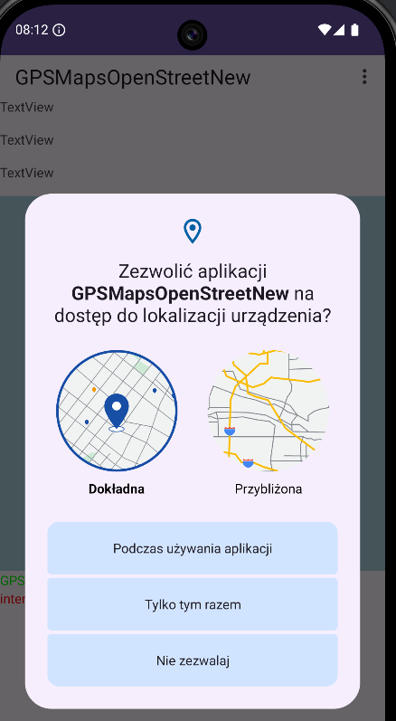

1. Część druga -- dodanie mapy

   

1. Parametry:

   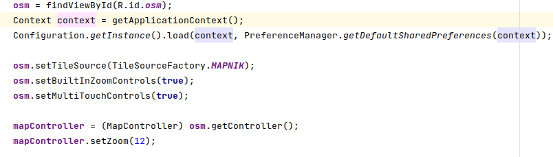

   Zmieniamy dostawcę kafelek od roku 2026:

   ```java
   XYTileSource cyclOSM = new XYTileSource(
                "CyclOSM",
                0, 20, 256, ".png",
                new String[]{
                        "https://a.tile-cyclosm.openstreetmap.fr/cyclosm/",
                        "https://b.tile-cyclosm.openstreetmap.fr/cyclosm/",
                        "https://c.tile-cyclosm.openstreetmap.fr/cyclosm/"
                },
                "© OpenStreetMap contributors, CyclOSM"
        );
        map.setTileSource(cyclOSM);
   ```

1. Dodanie punktu:

   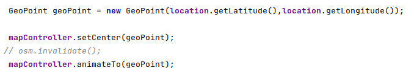

1. Dodanie markera i setMapListenera ( nie obligatoryjne ) :

   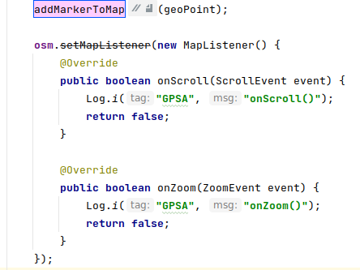

1. Dodaj iconę markera, najlepiej plik.png itp:

   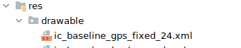

1. Marker:

   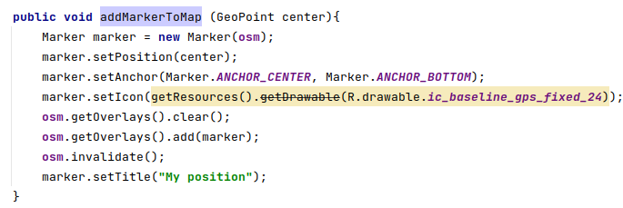

   lub po nowemu:

   ```java
    Drawable drawable = getResources().getDrawable(R.drawable.marker, null);
        Bitmap bitmap = Bitmap.createScaledBitmap(
                ((BitmapDrawable) drawable).getBitmap(),
                35,
                35,
                true
        );
        drawable = new BitmapDrawable(getResources(), bitmap);
        marker.setIcon(drawable);
   ```

1. Dodaj obligatoryjnie menu, zalecane railway navigation :( opis i objaśnienie w punkcie 25)

   <https://m3.material.io/components/navigation-rail/guidelines>

   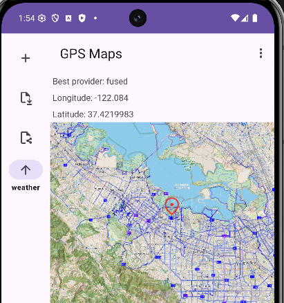
   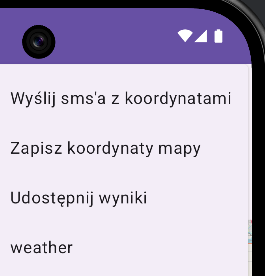

1. Dodaj metodę sprawdzającą dostęp do GPS i internetu (colory czerwony
    i zielony na TextView)

   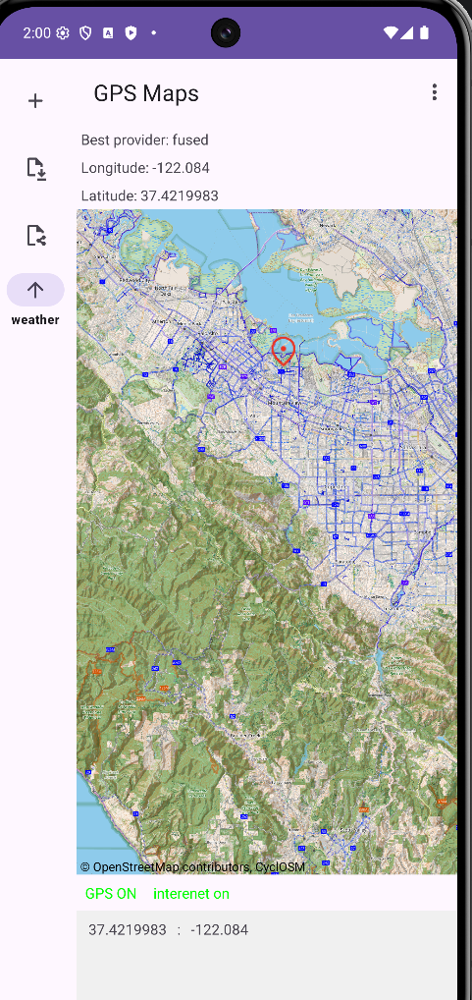

1. Wykonaj zadania
   - wysłanie sms-em koordynat

     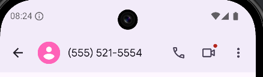

     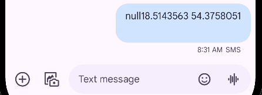

   - zapisanie zdjęć mapy na karcie

     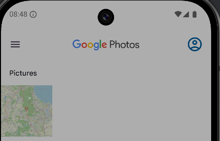

   - udostępnienie wyników

     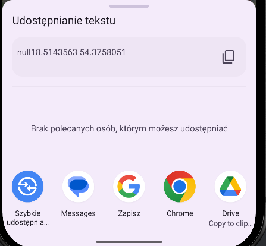

1. Dodatkowe zadanie: wczytaj dane
    pogodowe dla obecnej lokalizacji:

   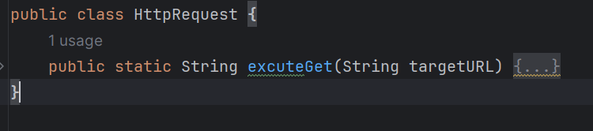

   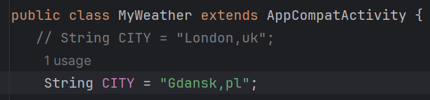

   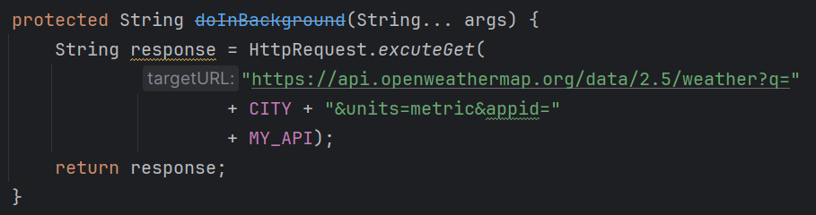

   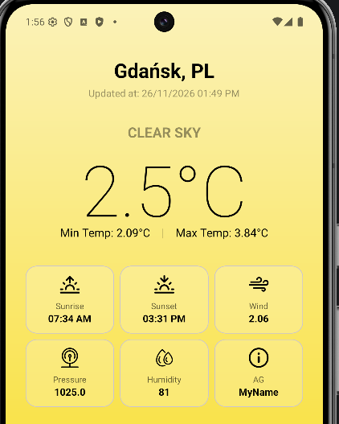
1. Dla chętnych skorzystaj z retrofit2:

   ```xml
     dependencies {
       implementation("androidx.activity:activity-ktx:1.13.0")
       // Retrofit
       implementation("com.squareup.retrofit2:retrofit:3.0.0")
       // konwerter Gson do automatycznego zamieniania JSONa na obiekty Java
       implementation("com.squareup.retrofit2:converter-gson:3.0.0")
     }
   ```

1. KONIEC.🔚
