# Ćwiczenia 17 -- Android studio -- GPS, Open Street Maps

Na koniec zajęć prześlij pliki źródłowe (.xml, .java)+ obrazek do zasobu
w teams.

1. Utwórz projekt o nazwie GpsMaps na podstawie Empty Activity, dobierz
    odpowiednie API ( min. 26).

1. Otworzyć dokumentację:

   <https://developer.android.com/training/location/permissions>

   <https://developer.android.com/reference/kotlin/android/location/LocationManager?hl=en>

   <https://developer.android.com/training/location/request-updates>

   <https://developer.android.com/reference/android/location/Location>

1. Dodaj zależności ( aktualna wersja na

   <https://github.com/osmdroid/osmdroid>):

   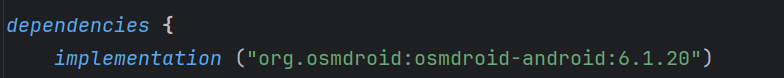

1. Docelowo chcemy uzyskać coś na kształt( marker ustawić na
    czerwony!!!):

   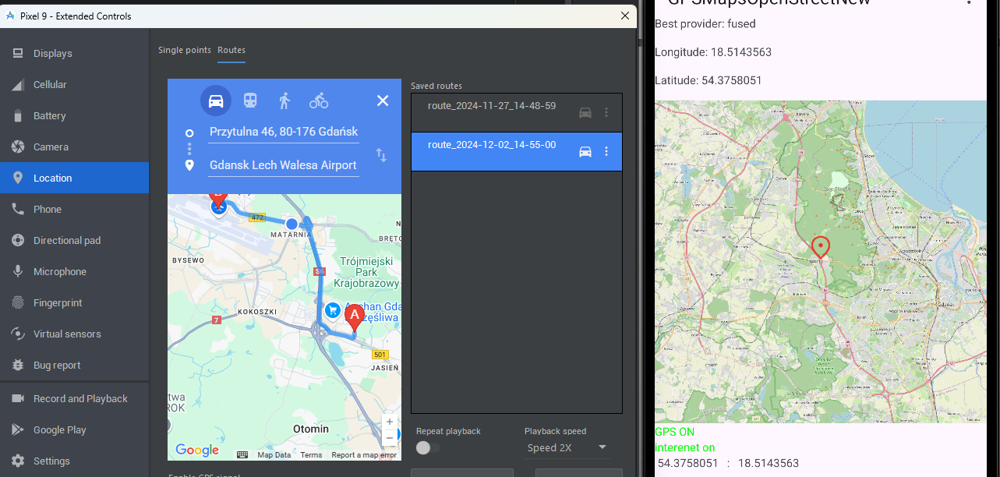

1. Stwórz podstawowe struktury np.:

   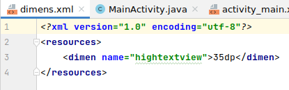

1. Stwórz layout dla aplikacji jak poniżej lub podobny:

   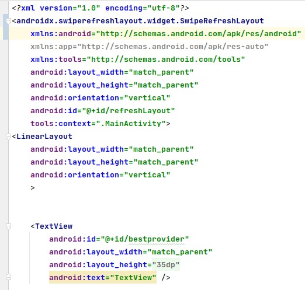

   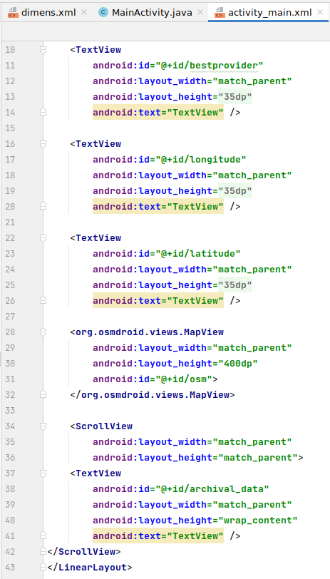

1. Dodaj listener dla layoutu SwipeRefreshLayout:

   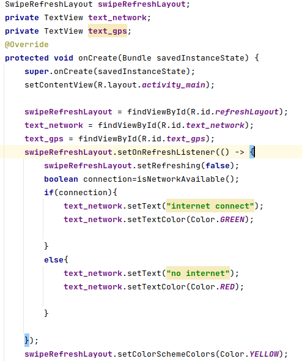

1. Zadeklaruj w MainActivity.java:

   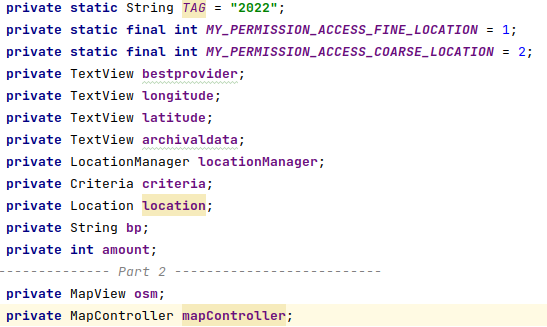

1. W onCreate() dodaj:

   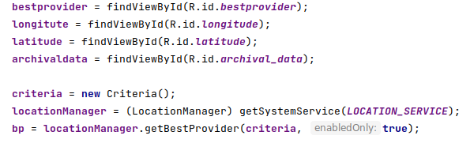

1. Dodaj ( ważne: zwróć uwagę na kolejne dwa punkty!!! ):

   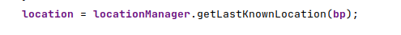

1. W AndroidManifest.xml sprawdź czy masz uprawnienia:

   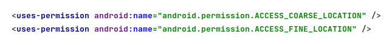

1. Add permission check ( if z checkSelfPermission doda się
    automatycznie po wybraniu tej opcji)

   W trakcie realizacji ćwiczeń należy dodać stosone inne, wymagane uprawnienia!!!

   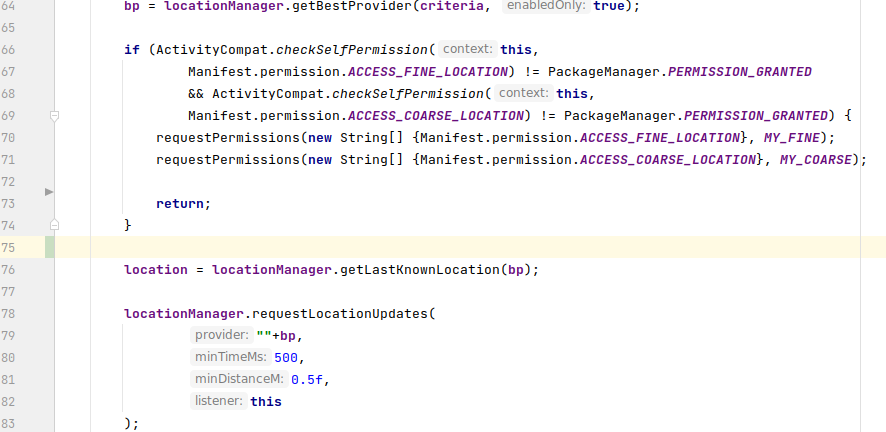

1. Sprawdź czy zaimplementowałeś/aś metodę
    onRequestPermissionResult, np.:

   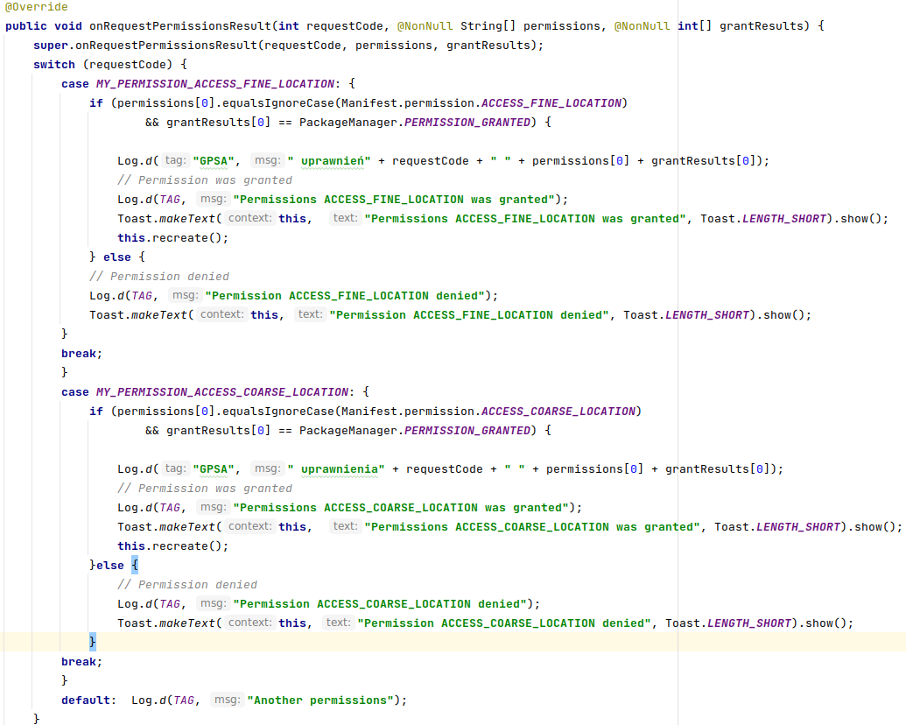

1. Sprawdź czy wypisujesz odczyty:

   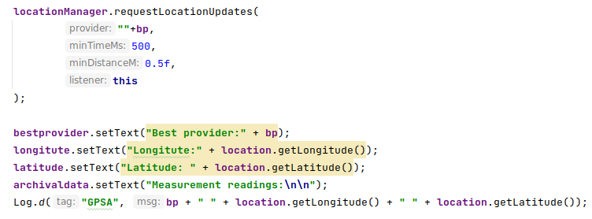

1. Zaimplementuj LocationListener z potrzebnymi metodami:

   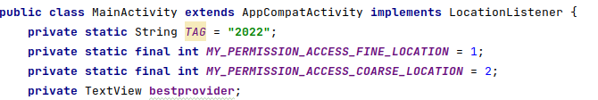

   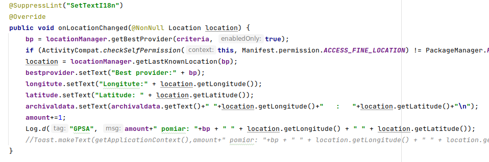

1. Przetestuj aplikację, uruchom na urządzeniu. Przemieść się .

   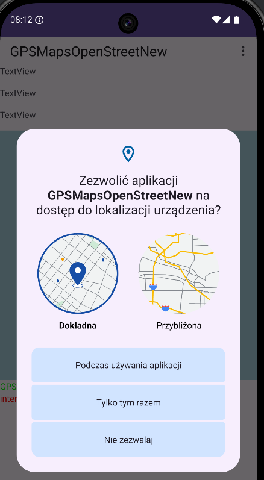

1. Część druga -- dodanie mapy

   

1. Parametry:

   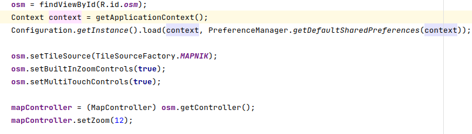

1. Dodanie punktu:

   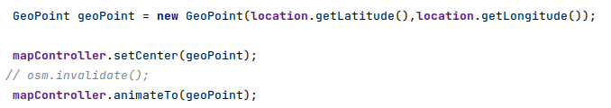

1. Dodanie markera i setMapListenera ( nie obligatoryjne ) :

   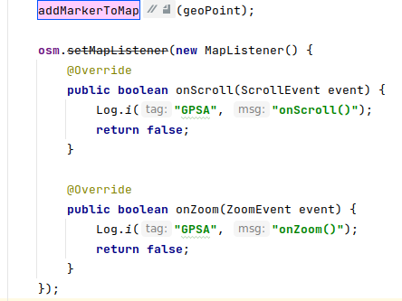

1. Dodaj iconę markera, najlepiej plik.png itp:

   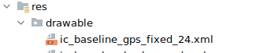

1. Marker:

   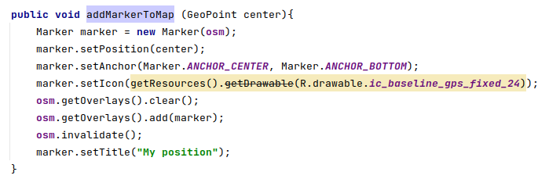

1. Dodaj obligatoryjnie menu górne:( opis i objaśnienie w punkcie 25)

   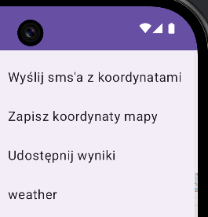

1. Dodaj metodę sprawdzającą dostęp do GPS i internetu (colory czerwony
    i zielony na TextView)

   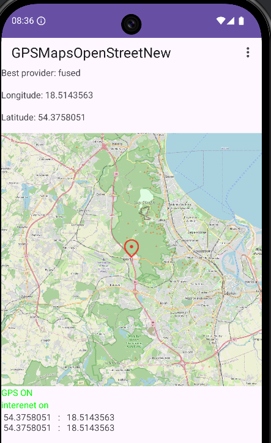

1. Wykonaj zadania
   - wysłanie sms-em koordynat

     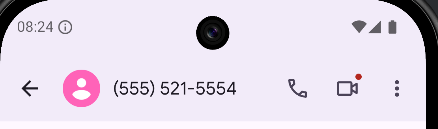

     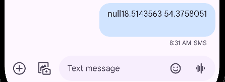

   - zapisanie zdjęć mapy na karcie

     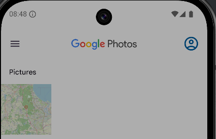

   - udostępnienie wyników

     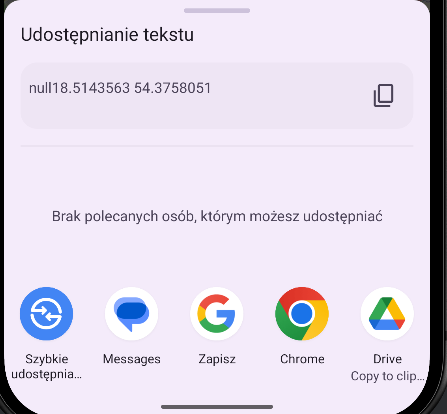

   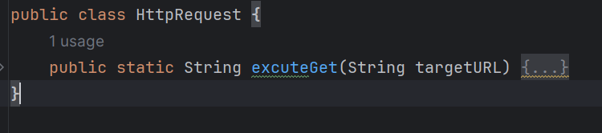

1. Dodatkowe zadanie: wczytaj dane
    pogodowe dla obecnej lokalizacji:

    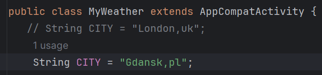

   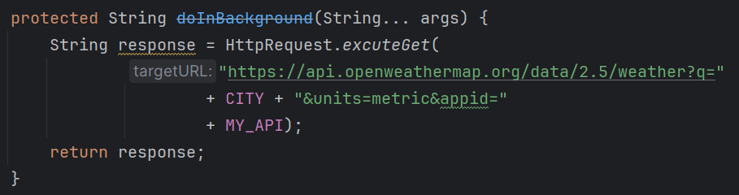

   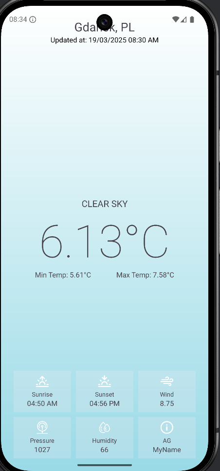

1. KONIEC.🔚
