# Ćwiczenia 21 -- Android studio -- sms, email send, shortcut

Na koniec zajęć prześlij pliki źródłowe (.xml, .java)+ obrazek do zasobu
w teams.

1. Utwórz projekt o nazwie MySmsMailShortcut na podstawie Empty
    Activity, dobierz odpowiednie API ( 28 -- Android 9).

1. Otwórz dokumentację:

   <https://developer.android.com/guide/components/intents-common#ComposeEmail>

   <https://developer.android.com/guide/components/intents-common#SendMessage>

   <https://developer.android.com/reference/android/telephony/SmsManager>

   <https://developer.android.com/guide/topics/ui/shortcuts>

1. W AndroidManifest.xml dodaj uprawnienia:

   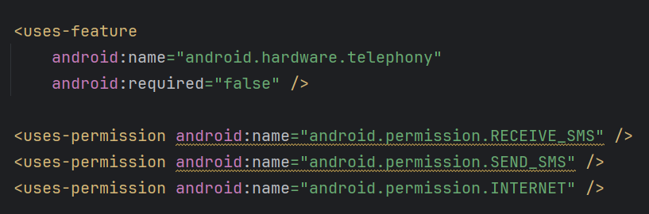

1. Przygotuj activity_main.xml, podanie:
   - numeru telefonu,
   - treści wiadomości,
   - przyciski do wysyłki smsa,
   - przycisk do wysyłania maila,
   - pole dla emaila,
   - miejsce do odbioru smsów

1. Przykładowa struktura projektu:

   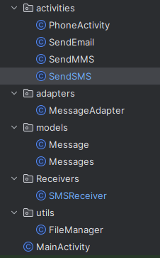

1. Dodaj potrzebne zmienne, np.:

   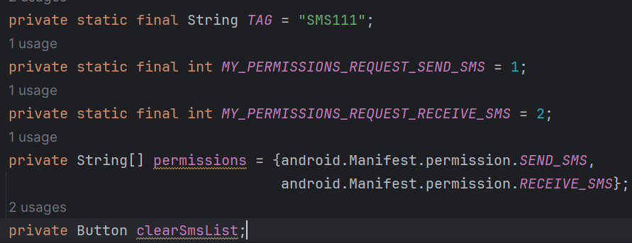

1. Stwórz metodę wysyłającą sms poprzez SmsManagera, np.:

   Java:

   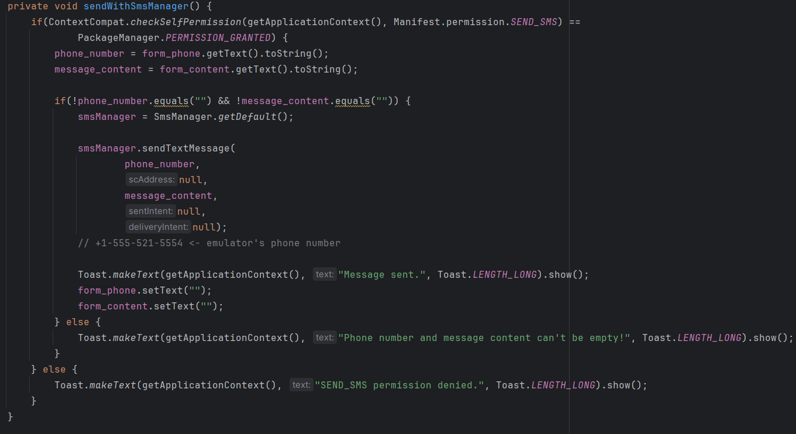
   
   Kotlin:
   ```java
   private fun sendWithSmsManager() {
        if (ContextCompat.checkSelfPermission(this, Manifest.permission.SEND_SMS)
            == PackageManager.PERMISSION_GRANTED
        ) {
            val phoneNumber = formPhone.text.toString()
            val message = formContent.text.toString()

            if (phoneNumber.isNotEmpty() && message.isNotEmpty()) {
                smsSender.sendText(phoneNumber, message)
                Toast.makeText(this, "Message sent.", Toast.LENGTH_LONG).show()
                formPhone.text.clear()
                formContent.text.clear()
            } else {
                Toast.makeText(
                    this,
                    "Phone number and message content can't be empty!",
                    Toast.LENGTH_LONG
                ).show()
            }
        } else {
            Toast.makeText(this, "SEND_SMS permission denied.", Toast.LENGTH_LONG).show()
        }
    }
   ```

1. Przetestuj aplikację, np.:

   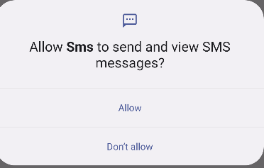

   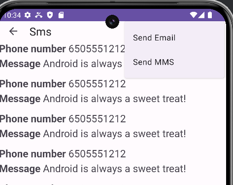

   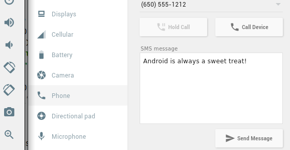

1. Stwórz metodę wysyłającą sms poprzez Intent, np.:

   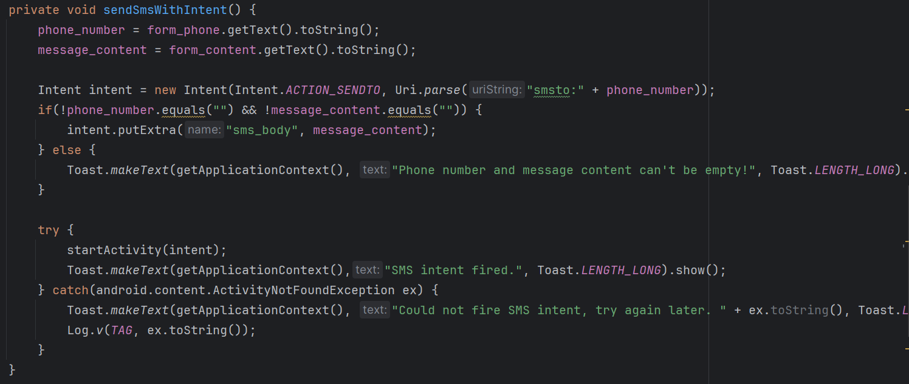

1. Wyślij mail poprzez Intent, np.:

   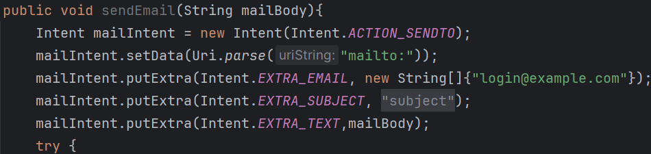

1. Przetestuj wysyłanie maila.

   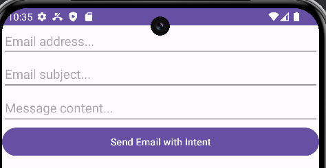

1. Dodaj klasę MyReceiver.java rozszerz ją o BroadcastReceiver

   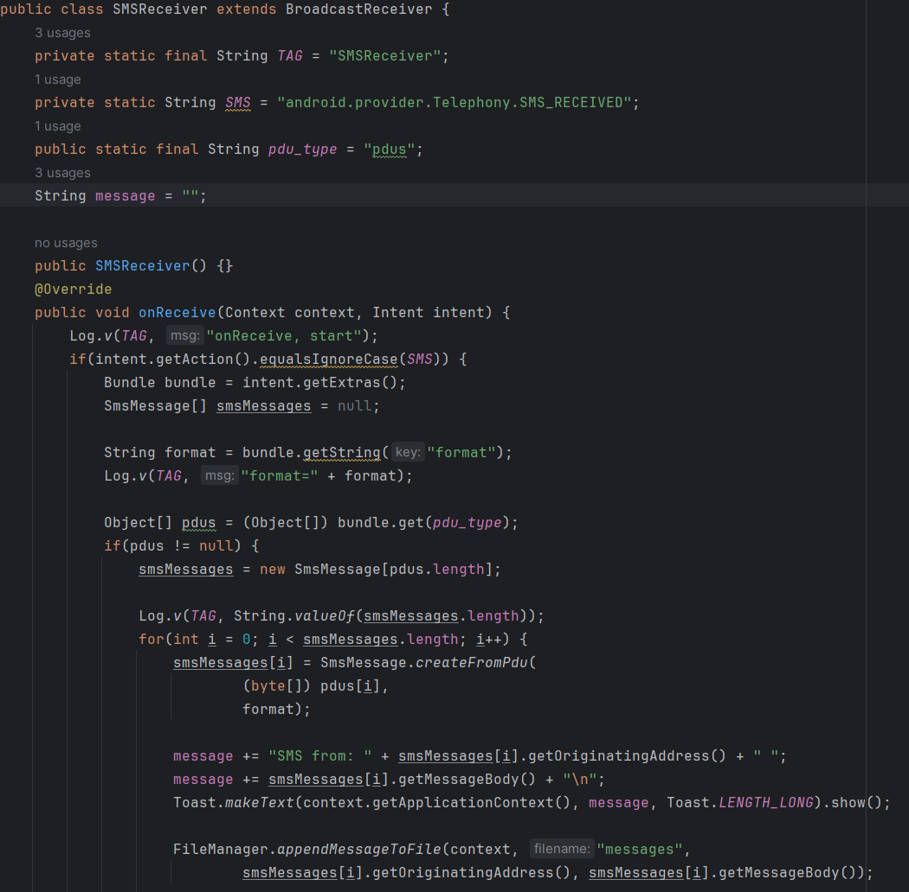

1. Możesz zapisać w onReceive() przychodzące smsy do pliku

   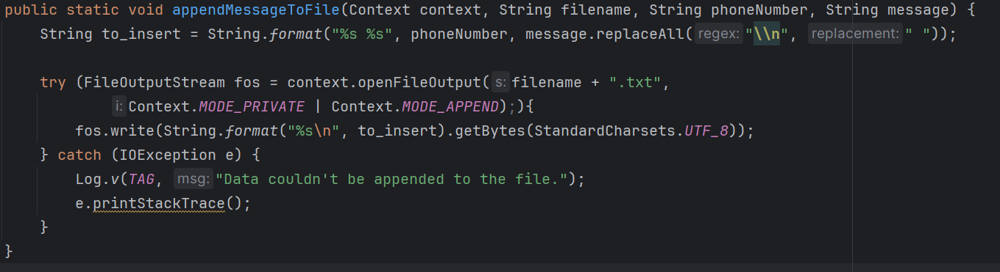

1. Dodaj w AndroidManifest.xml obsługę odbiornika

   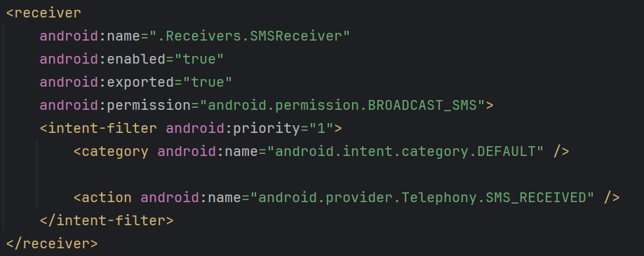

1. Przetestuj odbiór smsów.

1. Dodaj skróty w ikonie aplikacji dla funkcjonalności:

   - wyślij sms ( skrót statyczny)
   - wyślij email ( skrót statyczny)
   - wyślij mms ( skrót dynamiczny)
   - zadźwoń dla chętnych , lub otwarcie przeglądarki

     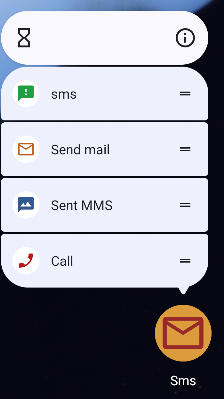

   Dokumentacja:

   <https://developer.android.com/guide/topics/ui/shortcuts/creating-shortcuts>

1. Realizacja dla skrótów statycznych:

   - Zawartość z AndroidManifest.xml:
     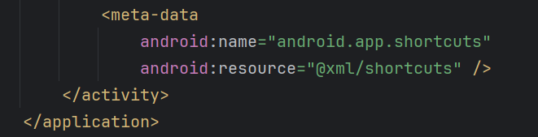

     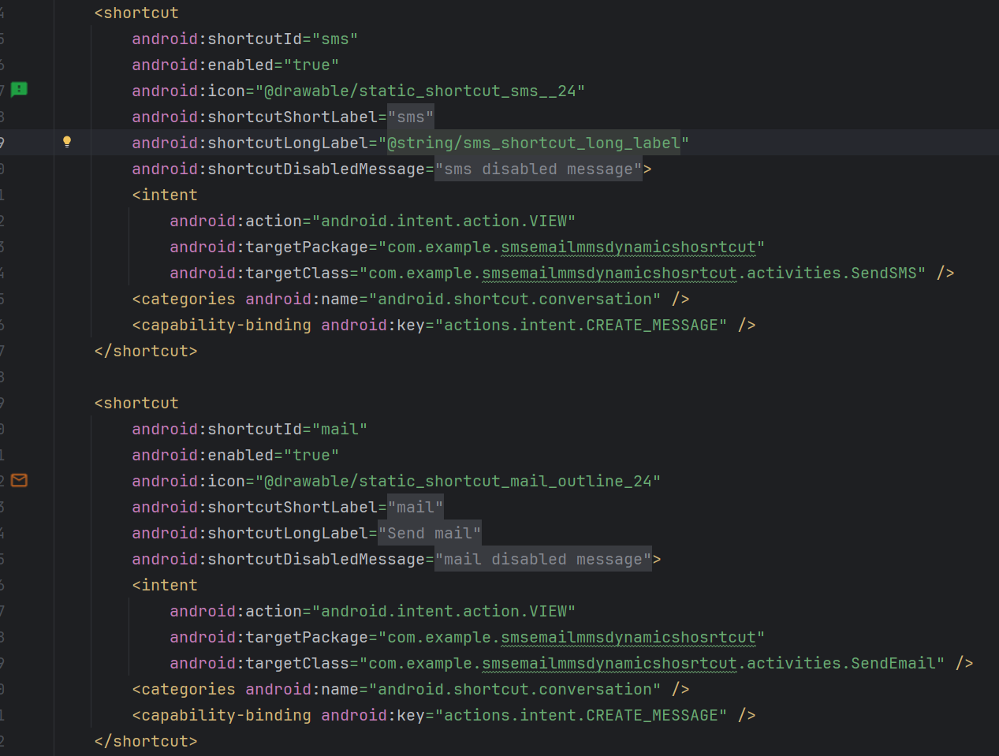

1. Realizacja skrótów dynamicznych:

   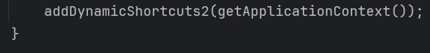

   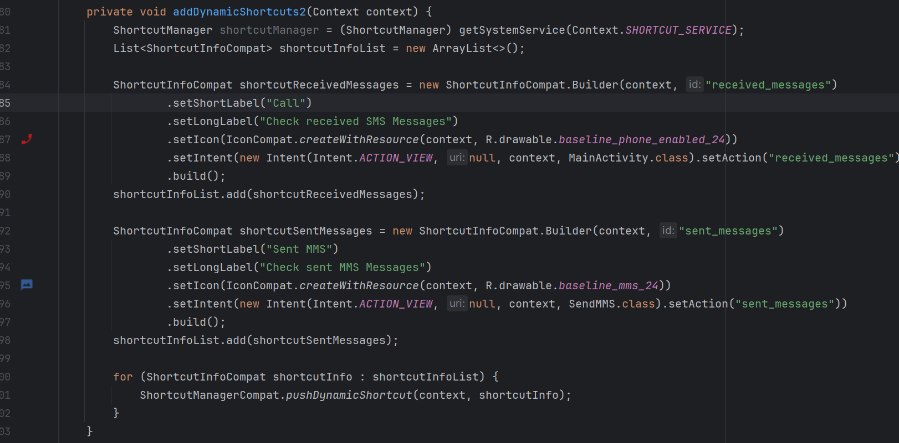

1. Zrealizuj dodatkowo zadania
   - zaimplementuj wysyłanie wieloczęściowego smsa

     Dokumentacja:
     <https://developer.android.com/reference/android/content/Intent#ACTION_SEND_MULTIPLE>

     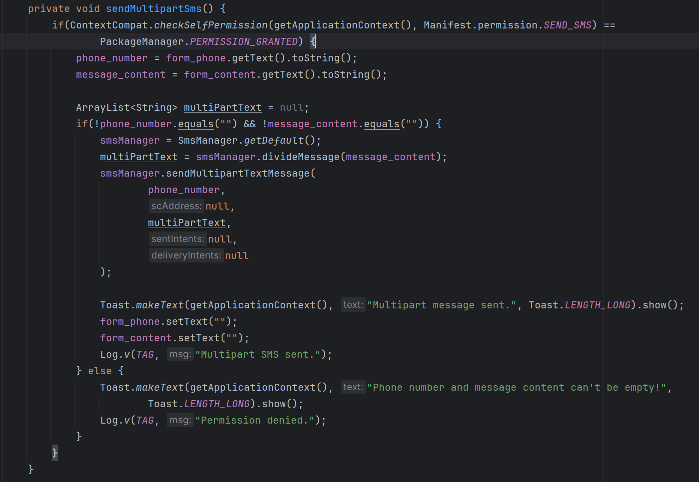

   - zaimplementuj wysyłanie mmsa
   - zapisanie przychodzących smsów i wyświetlenie w menu na RecycledView

     Dokumentacja:
     <https://developer.android.com/guide/topics/ui/layout/recyclerview>

   - dodaj ikonę dla aplikacji New - \> Image Asset

     

     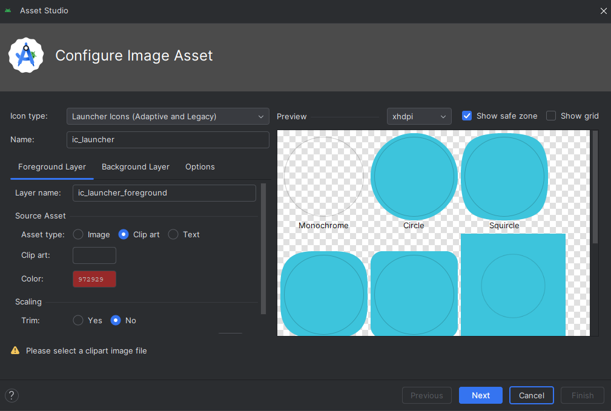

   - napisz klasę, w której zrealizujesz wykonanie rozmowy telefonicznej
     (dla chętnych)

1. Napisz test wysłania maila i go wykonaj:

   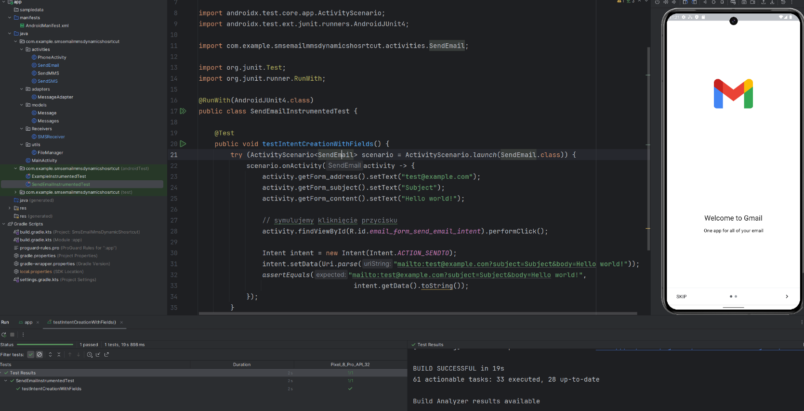

1. Napisz test z użyciem Espresso:

   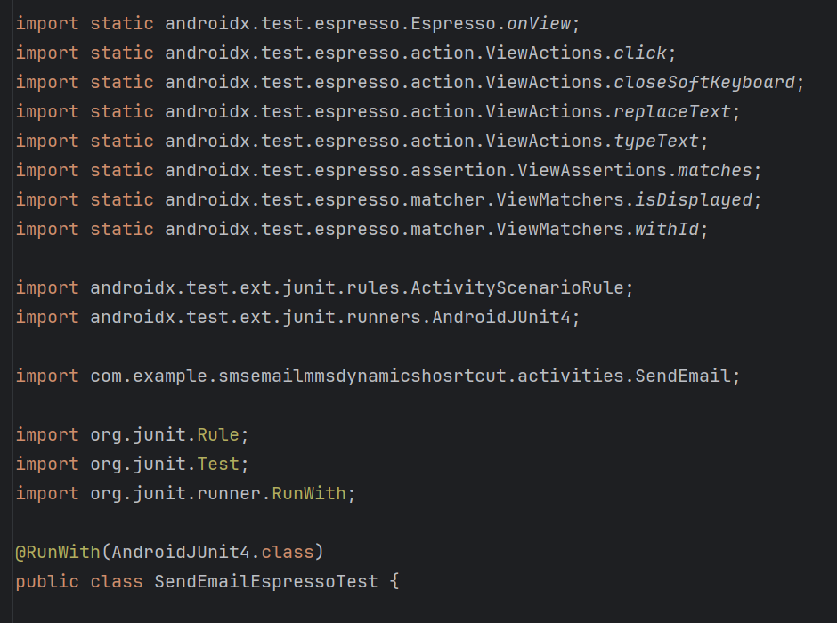

   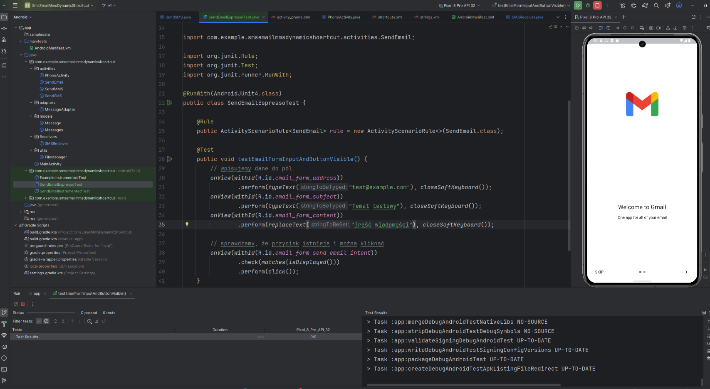

1. KONIEC. 🔚
