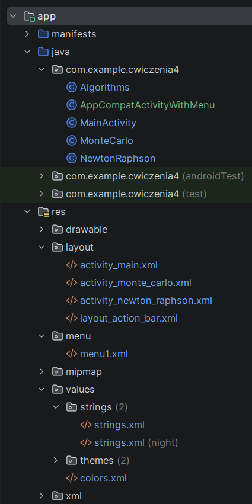
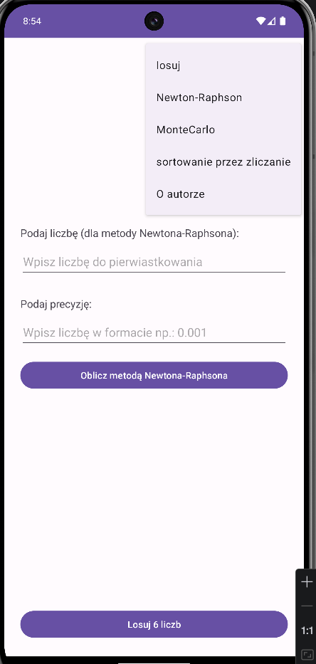
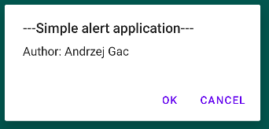
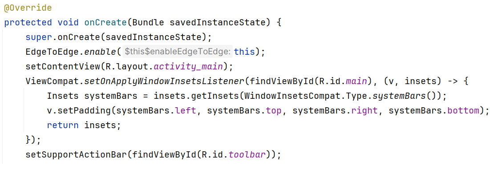
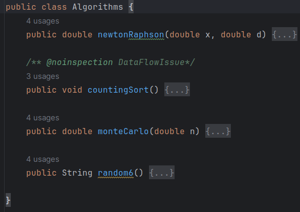
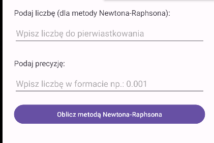
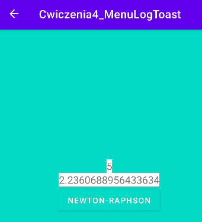
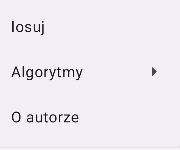
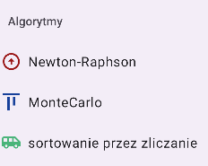
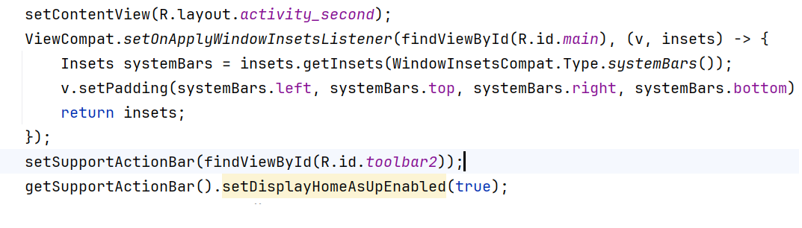

# Ćwiczenia 4,5 -- Android studio -- Menu, Log, Toast, onClick

Na koniec zajęć prześlij pliki źródłowe (\*.xml, \*.java)+ obrazek do
zasobu w teams.

1. Utwórz nowy projekt na podstawie Empty Activity (dobrać odpowiednie
    API ) w katalogu na dysku C:

1. Uruchomić aplikację Hello World Shift+F10 (zielony trójkącik)

1. Usunąć TextView dla Hello World.

1. Otworzyć dokumentację:

   <https://developer.android.com/studio/debug/logcat>

   <https://developer.android.com/develop/ui/views/components/menus>

   <https://developer.android.com/guide/topics/resources/menu-resource>

   <https://developer.android.com/guide/topics/ui/notifiers/toasts>

1. Pamiętaj, aby w pliku values\\strings.xml i values\\colors.xml
    umieścić kolory i teksty.

1. Napisz metodę losujLiczby, która wylosuje 6 liczb tak jak w dużym
    totolotku ( funkcja z wykładu ).

1. Sprawdź działanie metody dla przycisku.

1. Utwórz katalog w res o nazwie menu. ( prawy przycisk myszy na res

   New - \> Directory )

   

1. Utwórz plik o nazwie menu1 Menu Resource File. ( prawy przycisk
    myszy na res/menu )

1. Do tworzenia menu wykorzystaj z dokumentacji plik \*.xml oraz
    metody, utwórz je z pomocą `CTRL+o`:
    * onCreateOptionsMenu
    * onOptionsItemSelected

1. Dodaj do activity_main.xml potrzebne komponenty (Np. EditText do
    pobierania wartości itd.)

   

1. Utwórz menu z pięcioma pozycjami:

   * losuj ( duży totolotek, materiał z wykładu)
   * Newton-Raphson ( dla pierwiastka kwadratowego, materiał z wykładu )
   * Monte-Carlo ( wartość liczby pi, materiał z wykładu)
   * sortowanie przez zliczanie ( liczby całk. Sztuk 50, materiał z wykładu)
   * o autorze (wykorzystaj AlertDialog

      

   Dokumentacja:

   <https://developer.android.com/reference/android/app/AlertDialog.Builder>

   <https://developer.android.com/develop/ui/views/components/dialogs>

1. W activity_main.xml dodaj:

   ```xml
   <com.google.android.material.appbar.MaterialToolbar
        android:id="@+id/toolbar"
        android:layout_width="match_parent"
        android:layout_height="?attr/actionBarSize"
        android:background="?attr/colorAccent"
        />
   ```

1. Dodaj kod w MainActivity, ustaw pasek narzędzi tak, aby pełnił funkcję paska akcji dla tego okna aktywności:

   ```java
   setSupportActionBar(findViewById(R.id.toolbar));
   ```

   

1. Dla każdej pozycji menu utwórz metodę w klasie Algorithms, sprawdź działanie z pomocą Log i Toast.

   

1. Dodaj Empty Views Activity o nazwie NewtonRaphson do realizacji zadania 3.

1. Pobierz od użytkownika liczbę do pierwiastkowania i precyzję
    obliczeń i przekaż je do aktywności NewtonRaphson z pomocą putExtra.

    Realizacja samego algorytmu w aktywności NewtonRaphson.

   
   

1. Utwórz pozycję podmenu o nazwie algorytmy z pozycjami:

   * Newton-Raphson
   * MonteCarlo
   * sortowanie przez zliczanie

   

   

1. Zapewnij, aby menu pojawiło się w każdej z aktywności.

   

1. Zapewnij powrót z każdej aktywności za
    pomocą strzałki powrotnej.
1. Dodatkowe zadania:
   * dodaj pozycję sortowanie przez kopcowanie
   * inne podane przez nauczyciela

1. KONIEC. 🔚
