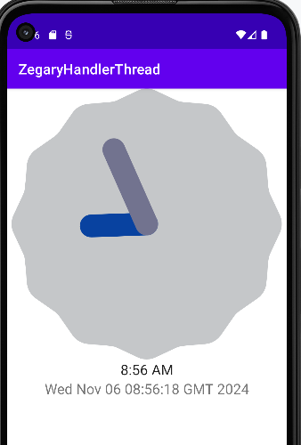
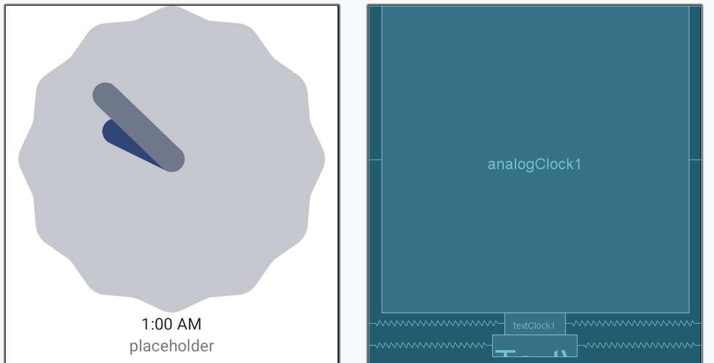
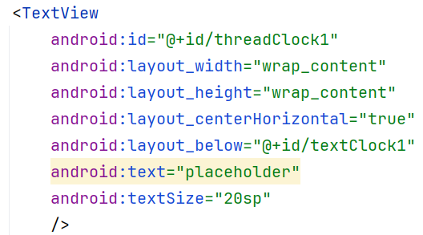
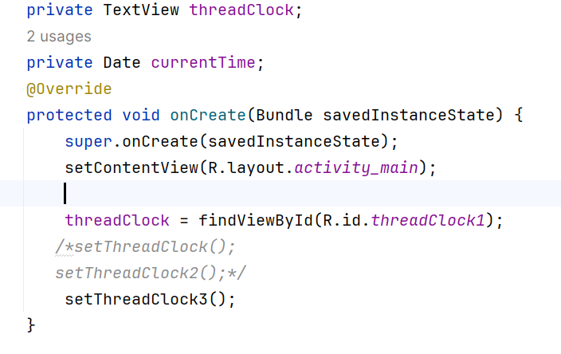

# Ćwiczenia 6 -- Android studio -- AnalogClock_TextClock_Thread, Runnable i Handler

Na koniec zajęć prześlij pliki źródłowe (\*.xml, \*.java)+ obrazek do
zasobu w teams.

1. Utwórz nowy projekt o nazwie Zegary na podstawie Empty Views Activity
    (dobrać odpowiednie API ).
1. Otworzyć dokumentację:
    <https://developer.android.com/reference/android/widget/TextClock#attr_android:format24Hour>
    <https://developer.android.com/reference/android/text/format/DateFormat>
    <https://www.unicode.org/reports/tr35/tr35-dates.html#Date_Format_Patterns>
    1. Pamiętaj, aby w pliku values\\strings.xml i values\\colors.xml
    umieścić kolory i teksty.
1. Efekt końcowy, ostatni zegar wyświetla zmieniające się sekundy:

> 

1. Wyświetl dwa zegary z użyciem komponentów:
AnalogClock
TextClock

2. Użyj format24Hour dla TextClock.
3. Dla TextClock wyświetl, także datę w formacie dd MM yyyy.
4. Na urządzeniu wirtualnym ustaw odpowiednią strefę czasową i format
    daty, czasu.
5. Utwórz trzeci zegar z użyciem klasy Thread lub klas
    Runnable,Handler.
6. Utwórz TextView dla trzeciego zegara:

> 

1. Otwórz dokumentację:

> <https://developer.android.com/reference/java/lang/Thread>
>
> <https://developer.android.com/guide/components/processes-and-threads#java>
>
> <https://developer.android.com/reference/android/os/Handler>
>
> <https://developer.android.com/reference/java/lang/Runnable>
>
> <https://developer.android.com/reference/android/icu/util/Calendar>
>
> <https://developer.android.com/reference/android/app/Activity#runOnUiThread(java.lang.Runnable)>
>
> <https://developer.android.com/reference/android/view/View#postDelayed(java.lang.Runnable,%20long)>

1. Utwórz trzy metody do testowania zegara:

> 

1. Wskazówki:

   ```java
    Calendar calendar = Calendar.*getInstance*();\
    **new** Thread()\
    \@Override\
    **public void** run()\
    **while**(!isInterrupted())\
    Thread.*sleep*(1000);\
    runOnUiThread(() -\> \
    textView.setText();\
    );\
    \
    \
    .start();
    lub
    Handler handler = **new** Handler();\
    Runnable runnable = **new** Runnable() \
    **public void** run() \
    textView.setText();\
    handler.postDelayed(**this**, 1000);\
    \
    ;\
    runnable.run();
    ```

2. Prześlij pliki źródłowe (\*.xml, \*.java)+ obrazek do zasobu w
    teams.
3. KONIEC.
