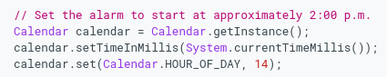
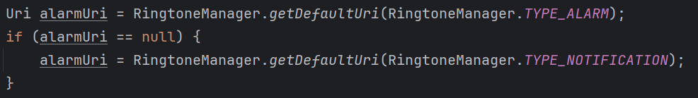
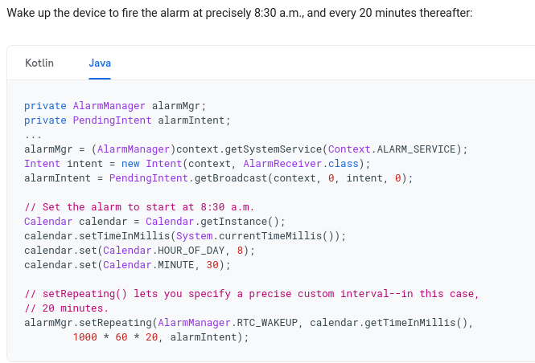
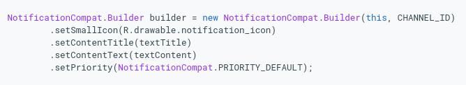
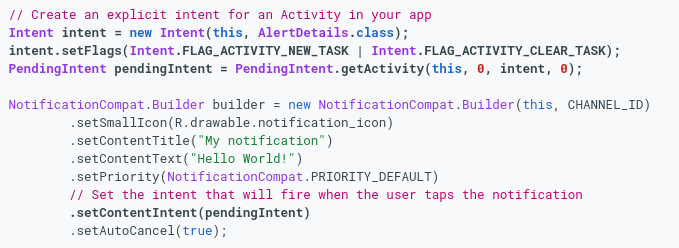
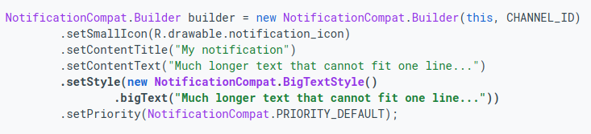
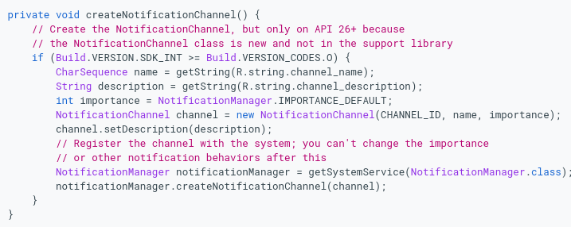
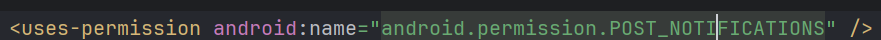
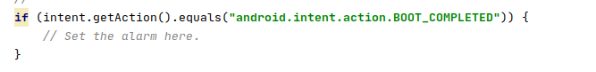
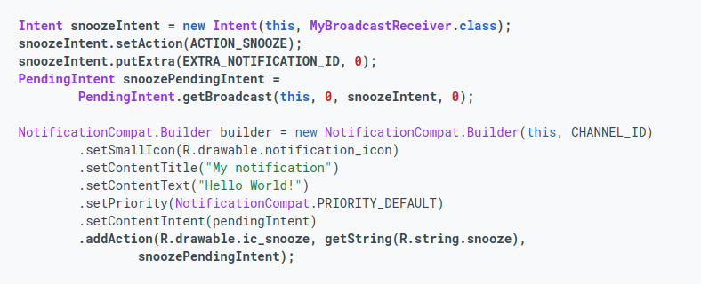

# Ćwiczenia 7,8 -- Android studio -- AlarmManager, BroadcastReceiver, Notification

Na koniec zajęć prześlij pliki źródłowe (\*.xml, \*.java)+ obrazek do
zasobu w teams.

1. Utwórz nowy projekt o nazwie Alarm na podstawie Empty Views Activity
    (dobrać odpowiednie API ).
1. Otworzyć dokumentację:

    <https://developer.android.com/training/scheduling/alarms>

    <https://developer.android.com/reference/android/app/AlarmManager>

    <https://developer.android.com/reference/android/content/BroadcastReceiver>

    <https://developer.android.com/reference/android/app/PendingIntent>

    <https://developer.android.com/reference/android/os/Vibrator>

    <https://m3.material.io/components/switch/overview>

    <https://m3.material.io/components/time-pickers/overview>

1. Pamiętaj, aby w pliku values\\strings.xml i values\\colors.xml
    umieścić kolory i teksty.

1. Dodaj komponenty:
    - TimePicker, do ustawienia czasu alarmu
    - MaterialSwitch, do włączenia/ wyłączenia
    - TextView do kontrolnego wyświetlenia wybranego czasu budzika

1. Użyj klas Log i Toast dla wyświetlenia czy alarm został
    włączony/wyłączony.

1. Dodaj w onCreate():

   ```java
   alarmManager = (AlarmManager) getSystemService(***ALARM_SERVICE***);
   ```

1. Dodaj dla MaterialSwitch listener.

1. Utwórz metodę switchClicked(), którą wywołasz w onCheckedChanged
    (CompoundButton buttonView, boolean isChecked)

1. Użyj klasy Calendar do ustawienia czasu.

   

1. Dodaj nową klasę o nazwie MyBroadcastReceiver, która rozszerza klasę
    BroadcastReceiver, następnie zaimplementuj metodę

   ```java
   @Override
   public void onReceive(Context context, Intent intent)
   ```

1. Utwórz obiekt klasy VibratorManager w metodzie onReceive i przypisz

   ```java
   getSystemService(context.VIBRATOR_MANAGER_SERVICE) 
   ```

   dla context

1. Dla metody vibrate() dodaj

    <https://developer.android.com/reference/android/os/VibrationEffect#createOneShot(long,%20int>)

1. Zaakceptuj dodanie:

   ```xml
   <uses-permission android:name="android.permission.VIBRATE" \>
   ```

1. Dla Uri dodaj fragment kodu:

   

1. Utwórz obiekt klasy Ringtone,

   <https://developer.android.com/reference/android/media/Ringtone?hl=ja>

   a dla RingtoneManagera

   <https://developer.android.com/reference/android/mediaRingtoneManager#getRingtone(android.content.Context,%20android.net.Uri>)

1. Wywołaj play().

1. W metodzie switchClicked() stwórz Intent dla MyBroadcastReceiver
    jak poniżej:

   

1. Dodaj do pliku AndroidManifest.xml, receiver:

   <https://developer.android.com/guide/topics/manifest/receiver-element>

1. Dodaj powiadomienie.

1. Otwórz dokumentację:

    <https://developer.android.com/training/notify-user/build-notification>

    <https://developer.android.com/reference/android/app/NotificationChannel>

    <https://developer.android.com/training/notify-user/channels>

    <https://developer.android.com/training/notify-user/expanded>

    <https://developer.android.com/training/notify-user/navigation>

1. Dodaj Empty Views Activity o nazwie Notification do realizacji
    wyskakującego powiadomienia.

1. Dodaj Intent dla Notification.class w

   ```java
   public void onReceive(Context context, Intent intent)
   ```

1. Dla intentu ustaw flagi

   ```java
   Intent.FLAG_ACTIVITY_NEW_TASK | Intent.FLAG_ACTIVITY_CLEAR_TASK
   ```

1. Utwórz PendingIntent z getActive() na Intent.

1. Ustaw treść powiadomienia w metodzie **public void**
    onReceive(Context context, Intent intent)

   

1. Powinieneś uzyskać coś na kształt:

   

1. Dodaj setStyle

   

1. Dodaj kanał powiadomień w MainActivity.java w metodzie

   ```java
   private void createNotificationChanel()
   ```

   

1. Wywołaj powyższą metodę zaraz po starcie aplikacji.( w onCreate())

1. Od wersji android 13+,tiramisu, API 33 potrzebne jest żadanie
    uprawnienia:

   

   <https://developer.android.com/training/permissions/requesting?hl=pl#java>

1. Przetestuj działanie aplikacji.

1. Zmodyfikuj metodę dla alarmu ( zamień setRepeating na inną, zmień
    też RTC_WAKEUP).

1. Zadania dodatkowe:
   - zaprojektuj uruchamianie alarmu nawet po wyłączeniu urządzenia
     wskazówka. 1

     

     wskazówka 2

    ```xml
    <uses-permission android:name="android.permission.RECEIVE_BOOT_COMPLETED"\>
    ```

   - dodaj obsługę wyłączenia alarmu
   - dodaj obsługę drzemki SNOOZE

      

1. KONIEC.🔚
